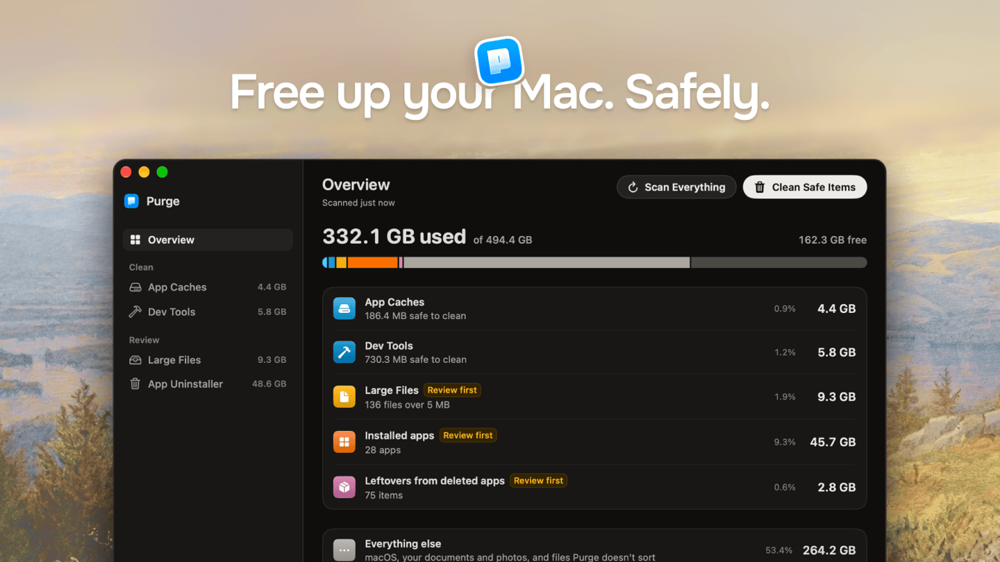

[English](README.md) | [简体中文](README.zh-CN.md) | [Русский](README.ru.md) | [Українська](README.uk.md) | العربية | [Türkçe](README.tr.md)

<div align="center">

  

  <h1>Purge</h1>

  <p dir="rtl"><b>حرّر مساحة Mac. بأمان.</b></p>

  <p dir="rtl">
    تطبيق Mac أصلي مجاني ومفتوح المصدر يزيل ملفات ذاكرة التخزين المؤقت والملفات غير الضرورية التي يكدّسها Mac من تلقاء نفسه.<br/>
    تُنقل الملفات إلى سلة المهملات افتراضيًا، لذا يمكنك استعادتها.
  </p>

<p>
  <a href="https://purgemac.com"></a>
  <a href="https://github.com/jithin-sabu/purge-app/actions/workflows/build.yml"></a>
  <a href="https://github.com/jithin-sabu/purge-app/blob/main/LICENSE"></a>
  <a href="https://github.com/jithin-sabu/purge-app/releases/latest"></a>
  <a href="https://github.com/jithin-sabu/purge-app/releases"></a>
  <a href="https://github.com/jithin-sabu/purge-app/stargazers"></a>
</p>

<p>
  <a href="https://trendshift.io/repositories/64435" target="_blank"><picture><source media="(prefers-color-scheme: dark)" srcset="https://trendshift.io/api/badge/repositories/64435?theme=dark"></picture></a>
</p>

  <p dir="rtl">
    <a href="https://github.com/jithin-sabu/purge-app/releases/latest"><b>تنزيل</b></a>
    &nbsp;·&nbsp;
    <a href="#التثبيت">دليل التثبيت</a>
    &nbsp;·&nbsp;
    <a href="#البناء-من-المصدر">البناء من المصدر</a>
    &nbsp;·&nbsp;
    <a href="#الأمان">الأمان</a>
  </p>

  

</div>

<div dir="rtl">

---

يمتلئ Mac بصمت بملفات ذاكرة التخزين المؤقت والملفات غير الضرورية التي لا تراها ولم تطلبها قط. يعثر عليها Purge، ويحدّد ما هو آمن منها، ويزيلها بنقرة واحدة. تُنقل الملفات إلى سلة المهملات، فيمكنك استعادتها.

## التثبيت

يتطلب Purge نظام macOS 13 أو أحدث.

**باستخدام Homebrew**

<div dir="ltr">

```bash
brew install --cask purge
```

</div>

**أو نزّله مباشرة**

1. نزّل ملف `.dmg` من [أحدث إصدار](https://github.com/jithin-sabu/purge-app/releases/latest).
2. افتحه واسحب Purge إلى مجلد التطبيقات.
3. افتح Purge. التطبيق موثّق من Apple، لذا يُفتح دون خطوات إضافية.

<details>
<summary>تحقّق من الملف الذي نزّلته (اختياري)</summary>

يأتي مع كل إصدار ملف `.dmg.sha256`. نزّله في المجلد نفسه الذي فيه ملف `.dmg`، ثم شغّل:

<div dir="ltr">

```bash
cd ~/Downloads
shasum -a 256 -c Purgev*.dmg.sha256
```

</div>

إذا انتهت النتيجة بـ `OK` فالملف مطابق تمامًا للملف المنشور.

</details>

**الوصول الكامل إلى القرص اختياري.** من دونه يفحص Purge الذاكرة المؤقتة وأدوات المطوّرين. ومعه يعثر Purge أيضًا على الذاكرة المؤقتة لتطبيقات App Store، والملفات الكبيرة، والتطبيقات المثبّتة، وبقايا التطبيقات المحذوفة. يسألك Purge عنه في نهاية التشغيل الأول، ويمكنك إيقافه في أي وقت من إعدادات النظام.

## الميزات

- **نظرة عامة**: اعرف أين ذهبت مساحة القرص، وانقل كل العناصر «آمن للتنظيف» إلى سلة المهملات دفعة واحدة
- **الذاكرة المؤقتة**: ذاكرة التطبيقات المؤقتة، والسجلات، وتقارير الأعطال، وبقايا مثبّتات macOS
- **أدوات المطوّرين**: الذاكرة المؤقتة لـ Xcode وHomebrew وnpm وDocker وغيرها، وأجهزة المحاكاة، ومجلدات البناء مثل `node_modules` في المشاريع التي لم تعد تعمل عليها
- **الملفات الكبيرة**: الملفات الكبيرة، والنسخ المكررة، والأجهزة الافتراضية، ونماذج الذكاء الاصطناعي المحلية، مع معاينة Quick Look قبل الحذف
- **إزالة التطبيقات**: تزيل التطبيق مع ذاكرته المؤقتة وإعداداته وبقاياه الأخرى
- **التنظيف المجدول**: ينظّف العناصر «آمن للتنظيف» أسبوعيًا أو شهريًا أو وفق الجدول الذي تختاره
- **شريط القوائم والاختصارات وFinder**: أيقونة اختيارية في شريط القوائم، وإجراءات في تطبيق الاختصارات، وخيار «إلغاء التثبيت باستخدام Purge» في قائمة النقر بزر الماوس الأيمن في Finder
- **خمس لغات**: الإنجليزية والصينية المبسّطة والروسية والتركية والعربية

كل ميزة وإعداد واختصار لوحة مفاتيح موصوف في صفحة [Purge in detail](docs/features.md) (بالإنجليزية).

## الأمان

يحذف Purge الملفات، لذا يأتي الأمان أولًا.

- **سلة المهملات افتراضيًا.** تُنقل الملفات والمجلدات إلى سلة المهملات، ولا يُفرغ Purge سلة المهملات أبدًا. أشياء قليلة تُحذف نهائيًا، ويوضّح Purge ذلك حيث تختارها: أجهزة محاكاة iOS وبيئات تشغيلها، وMetal Toolchain في Xcode، واللقطات المحلية لـ Time Machine، ونماذج Apple Intelligence، والأدوات أو التطبيقات التي تختار إزالتها بمدير الحزم الخاص بها. [القائمة الكاملة](docs/features.md#what-goes-to-the-trash-and-what-is-removed-for-good) (بالإنجليزية).
- **قائمة سماح فقط.** لا ينظّف Purge إلا المواقع الموجودة في قائمة السماح الآمنة، ولا يمسّ ما لا يعرفه. تسرد [صفحة الأمان](https://purgemac.com/safety/) كل هذه المواقع.
- **تصنيفات يمكنك التحقق منها.** يحمل كل عنصر تصنيف «آمن للتنظيف» أو «افحص أولًا» مع شرح بلغة بسيطة. التنظيف بنقرة واحدة والتنظيف المجدول لا يأخذان إلا العناصر «آمن للتنظيف».
- **المساعد بصلاحيات الجذر متوقف افتراضيًا.** المساعد الصغير الذي يعمل بصلاحيات الجذر، لإزالة التطبيقات التي ثبّتها مسؤول، يبقى متوقفًا حتى تشغّله بنفسك. الشيفرة المصدرية له في `PurgeHelper/`.
- **الخصوصية.** يعمل Purge على Mac بالكامل ولا يستخدم الذكاء الاصطناعي. الاتصال الوحيد بالشبكة هو التحقق اليومي من التحديثات، ويمكنك إيقافه.
- **مفتوح المصدر وموقّع.** منطق الحذف كله في هذا المستودع. التطبيق موثّق من Apple، ويرفض Purge أي تحديث غير موقّع بمفتاح المطوّر.

هل وجدت مسارًا قد يحذفه Purge وما كان ينبغي له؟ أبلغ عنه بشكل خاص عبر [SECURITY.md](SECURITY.md).

## الأسئلة الشائعة

**هل يمكنني التراجع عن التنظيف؟**
نعم، لكل ما ذهب إلى سلة المهملات: أعِده من سلة المهملات قبل أن تُفرغها. يعرض **الإعدادات ← التحديثات والسجل ← سجل التنظيف** أين ذهب كل شيء. ما حُذف نهائيًا لا يمكن استعادته، لكن Xcode وPurge يستطيعان تنزيل بعضه مجددًا.

**هل يحتاج Purge إلى الوصول الكامل إلى القرص؟**
لا. من دونه تحصل على الذاكرة المؤقتة وأدوات المطوّرين. ومعه تحصل أيضًا على الملفات الكبيرة وإزالة التطبيقات والبقايا.

**كيف أحدّث Purge؟**
يتحقق Purge من التحديثات مرة يوميًا ويعرض ملاحظات الإصدار قبل أن يثبّت أي شيء. يمكنك من **الإعدادات ← التحديثات والسجل** أن تسمح له بتثبيت التحديثات تلقائيًا أو أن توقف التحقق. وإن ثبّته عبر Homebrew فشغّل `brew upgrade --cask purge`. [المزيد عن التحديث](docs/features.md#updating) (بالإنجليزية).

**هل يرسل Purge أي شيء من Mac؟**
فقط طلب التحقق من التحديثات، وهو يرسل إصدار Purge ولا شيء عنك أو عن Mac. [المزيد عن الخصوصية](docs/features.md#privacy) (بالإنجليزية).

**كيف ألغي تثبيت Purge؟**
اختر **إلغاء تثبيت Purge…** من قائمة Purge. يوقف Purge كل ما يشغّله في الخلفية، ثم ينقل نفسه إلى سلة المهملات. [المزيد عن إلغاء التثبيت](docs/features.md#uninstalling) (بالإنجليزية).

## البناء من المصدر

تحتاج إلى macOS 13 أو أحدث وXcode 26 أو أحدث.

<div dir="ltr">

```bash
git clone https://github.com/jithin-sabu/purge-app.git
cd purge-app
open purge.xcodeproj
```

</div>

اختر المخطط **purge** واضغط **⌘R**. في **Signing & Capabilities** اختر فريقك أو **Sign to Run Locally**. البناء والاختبارات من سطر الأوامر موصوفة في [CONTRIBUTING.md](CONTRIBUTING.md#building-and-testing) (بالإنجليزية).

## المساهمة

نرحّب ببلاغات الأخطاء وملاحظات الأمان وطلبات السحب. ابدأ بقراءة [CONTRIBUTING.md](CONTRIBUTING.md). التغييرات التي تمسّ ما يستطيع Purge حذفه تخضع لمراجعة أدق، وهذا مقصود.

## الترخيص

MIT. راجع [LICENSE](LICENSE).

## الدعم

Purge مجاني. إن وفّر لك بعض المساحة، يمكنك دعمه من شاشة **حول** داخل التطبيق أو عبر [Buy Me a Coffee](https://buymeacoffee.com/jithinsabu).

<div align="center">

<a href="https://buymeacoffee.com/jithinsabu"></a>

</div>

</div>

---

<div align="center">

**Jithin Sabu**

<a href="https://jithinsabu.com"></a>
<a href="https://linkedin.com/in/jithinsabu"></a>
<a href="https://x.com/sabu_jithin"></a>
<a href="mailto:jithin@purgemac.com"></a>

</div>
