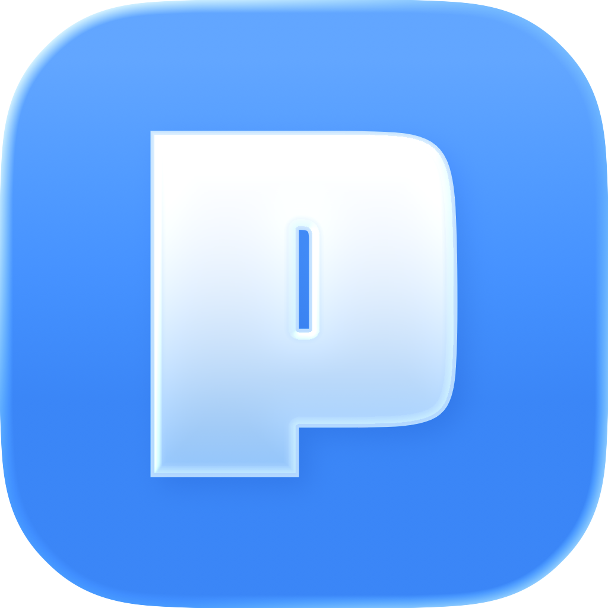
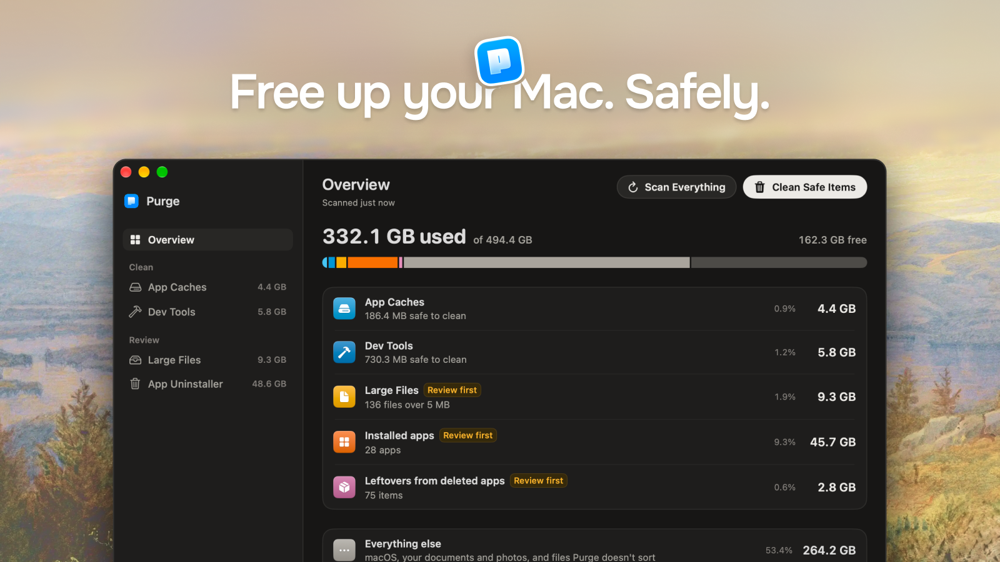

[English](README.md) | [简体中文](README.zh-CN.md) | Русский | [Українська](README.uk.md)

<div align="center">

  

  <h1>Purge</h1>

  <p><b>Освободите место на Mac. Безопасно.</b></p>

  <p>
    Бесплатное нативное приложение для Mac с открытым кодом, которое убирает кэш и мусор,<br/>
    накопившийся без вашего участия. Файлы по умолчанию отправляются в Корзину, так что их можно вернуть.
  </p>

<p>
  <a href="https://github.com/jithin-sabu/purge-app/actions/workflows/build.yml"></a>
  <a href="https://github.com/jithin-sabu/purge-app/blob/main/LICENSE"></a>
  <a href="https://github.com/jithin-sabu/purge-app/releases/latest"></a>
  <a href="https://github.com/jithin-sabu/purge-app/releases"></a>
  <a href="https://github.com/jithin-sabu/purge-app/stargazers"></a>
</p>

<p>
  <a href="https://trendshift.io/repositories/64435" target="_blank"><picture><source media="(prefers-color-scheme: dark)" srcset="https://trendshift.io/api/badge/repositories/64435?theme=dark"></picture></a>
</p>

  <p>
    <a href="https://github.com/jithin-sabu/purge-app/releases/latest"><b>Скачать</b></a>
    &nbsp;·&nbsp;
    <a href="#установка">Инструкция по установке</a>
    &nbsp;·&nbsp;
    <a href="#сборка-из-исходников">Сборка из исходников</a>
    &nbsp;·&nbsp;
    <a href="#безопасность">Безопасность</a>
  </p>

  

</div>

---

Ваш Mac тихо заполняется кэшем и мусором, которого вы не видите и не просили. Purge находит его, помечает то, что безопасно, и убирает одним щелчком.

> [!NOTE]
> Файлы и папки по умолчанию отправляются в Корзину, и Purge никогда её не опустошает, так что вернуть их можно до тех пор, пока вы не очистите Корзину сами. Удаляется навсегда: симуляторы и среды выполнения iOS — через `simctl` из Xcode; необязательный Metal Toolchain для Xcode — через `xcodebuild -deleteComponent` (Xcode скачает его снова, когда он понадобится проекту); локальные снимки Time Machine — через `tmutil` (Purge оставляет самый свежий и тот, что от вашей последней резервной копии); модели Apple Intelligence в macOS 27, которые освобождает служба ресурсов Apple и которые Purge может скачать снова; инструменты командной строки и приложения из cask Homebrew, которые удаляет их пакетный менеджер, если вы выбрали это в окне проверки. Папка Docker Desktop отправляется в Корзину. `docker system prune` Purge не запускает.

Разбираться во всём этом, чтобы пользоваться приложением, не нужно. Но если захотите проверить, у каждого элемента есть объяснение простым языком и метка безопасности, так что ничего не будет тронуто, чего вы не видели и не проверили.

---

## Возможности

### Обзор

- **Куда ушло место**: одна полоса на весь диск. Занято, свободно и всего берутся прямо из тома, поэтому совпадают с Системными настройками. У кэшей приложений, инструментов разработчика, больших файлов, установленных приложений и остатков удалённых приложений свой сегмент, а остальное показано как «всё остальное»
- Строка на каждую категорию: размер и доля диска. Щёлкните по ней, чтобы открыть вкладку
- **Всё остальное** тоже открывается. Щёлкните по строке — и страница покажет, что там лежит: четыре цифры о том, что можно сделать с этим местом, над картой, где каждая группа — рамка с самыми крупными папками внутри, по размеру занимаемого места и с цветом по типу. Типы: место, которое освобождается в другом приложении (Фото, Почта, Steam, Корзина), ваши собственные файлы (проекты, документы), то, что Purge не трогает, потому что не считает безопасным для удаления (кэши не из своего списка, данные приложений, на которые не претендует ни одно установленное приложение), и то, чем управляет macOS. Наведите на плитку, чтобы увидеть название, щёлкните — чтобы узнать, что это, и открыть «Показать в Finder» или собственный способ приложения освободить место. Страница только для чтения: ничто на ней не перемещает файлы
- **Сканировать всё** (⇧⌘R) проверяет каждую категорию по очереди, чтобы Mac оставался отзывчивым. При открытии Purge делает то же самое сам. Для больших файлов, списка приложений и остатков нужен «Полный доступ к диску». Без него Purge всё равно сканирует кэши приложений и инструменты разработчика и пропускает места, которые защищает macOS, например кэши приложений из песочницы
- Каждый байт считается один раз: папка кэша приложения учитывается в кэшах приложений и не повторяется в самом приложении
- **Скрыто в «Системных данных»**: карточка под категориями для места, которое macOS относит к «Системным данным». В её строке **Снимки Time Machine** удаляются локальные снимки, а в macOS 27 там же находятся модели Apple Intelligence
- **Модели Apple Intelligence** (macOS 27, Apple silicon): модели на устройстве, которые macOS складывает в раздел «Системные данные», без переключателя для их удаления. «Удалить» освобождает их через службу ресурсов Apple и устанавливает профиль, который вы один раз подтверждаете, чтобы они больше не скачивались. «Скачать снова» просит вас удалить профиль в Системных настройках, а затем запрашивает у macOS наборы, которые удалил Purge, на языке Siri. Показанный размер — цифра Apple; Purge записывает, сколько места диск действительно вернул

### Кэши приложений

Сканирует `~/Library/Caches`, кэши песочниц приложений (для них нужен «Полный доступ к диску») и обычный системный мусор:

- Папки кэша приложений с понятными названиями, иконками брендов и объяснением простым языком, если захотите прочитать
- Системный мусор: журналы приложений, отчёты о сбоях, установщики macOS и оставшиеся файлы обновлений macOS
- Большие медиакэши творческих приложений вроде Premiere Pro и After Effects
- Дублирующиеся места кэша одного приложения объединяются в одну строку
- Результаты появляются по мере находки

### Инструменты разработчика

Пять разделов в одном окне:

- **Общие кэши инструментов разработчика**: Xcode (Derived Data, Archives, DeviceSupport), Homebrew, npm, pnpm, Yarn, CocoaPods, Gradle, кэш pub для Dart и Flutter, Docker Desktop, VS Code, Cursor, JetBrains, Cargo, Terraform и другие
- **Симуляторы iOS**: каждый выключенный симулятор, по строке на каждый. Запущенный симулятор тоже показан, чтобы его место было учтено, но выбрать его нельзя
- **Среды выполнения симулятора**: по строке на каждую среду, которую `simctl` помечает как удаляемую
- **Компоненты Xcode**: необязательный Metal Toolchain для Xcode (около 900 МБ); удаляется через `xcodebuild -deleteComponent`, когда полная версия Xcode показывает его как установленный
- **Проекты разработчика**: `node_modules`, виртуальные окружения Python, `target` в Rust, результаты сборки Flutter, `Pods` в Xcode, `.gradle` в Android и другие артефакты, сгруппированные по проекту

Симуляторы, среды выполнения и компоненты Xcode всегда помечены «Сначала проверить». Они удаляются навсегда, а не отправляются в Корзину, и об этом сказано в заголовках их разделов.

В **Настройках → Очистка** выберите **Срок устаревания проектов** (от 1 месяца до 2 лет или «Показать все»), чтобы управлять тем, какие проекты показываются. Возраст считается от последнего изменения чего-либо в проекте, включая активность git, а не от даты у `node_modules` или `target`. Проект, который используется прямо сейчас — с запущенным в нём терминалом или dev-сервером либо выполняемой командой git, — не показывается никогда.

Рабочие копии git, созданные ИИ-инструментами для программирования (Cursor, Codex, Conductor, T3 Code и Claude Code), появляются в разделе **Осиротевшие рабочие копии git** только после того, как их репозиторий перестаёт их перечислять. Рабочая копия, которую git всё ещё использует, не появится, какой бы старой она ни была, как и та, в которой работает терминал или агент.

### Большие файлы

Найдите личные файлы, которые занимают много места, не копаясь в папках:

- Сканирует **Документы**, **Рабочий стол**, **Загрузки**, **Фильмы**, **Музыку** и **Изображения**, а также `~/Parallels` и `~/Virtual Machines.localized` — только для виртуальных машин, и собственную папку iCloud Drive — для файлов, которые можно хранить только в iCloud
- Папка, которую вы перенесли и заменили ссылкой, например `~/Documents`, указывающей на другой диск, сканируется там, куда ведёт ссылка, если это внутри вашей домашней папки или на диске в `/Volumes`, подключённом к вашему Mac. Её файлы показываются по настоящему пути и отправляются в Корзину того диска. Ссылка в любое другое место — например, в `~/Library/CloudStorage`, на сетевой ресурс, на целый диск или на копию Mac, — не отслеживается, а сканирование сообщает, куда она ведёт. Ссылки внутри папок не отслеживаются никогда
- Пропускает управляемые библиотеки (Фото, iMovie, Музыка и подобные), скрытые папки и папки проектов вроде `node_modules`, `Pods`, `DerivedData` и результаты сборки. Удалить один файл из дерева зависимостей — значит просто сломать установку, поэтому такие вещи относятся к инструментам разработчика, которые убирают их папкой целиком
- **Поиск** фильтрует список по мере ввода, сверяясь с именем файла, папкой, в которой он лежит, и его источником
- Фильтр по **размеру** (от 5 МБ до 1 ГБ) и **последнему использованию** (от любого времени до более года назад)
- Категории для видео, аудио, изображений, PDF, архивов, документов, моделей ИИ, виртуальных машин и прочих файлов
- **Дубликаты**: побайтовое сканирование находит идентичные копии, группирует их и показывает, сколько места освободится, если оставить одну. Категория **Дубликаты** собирает их в одном месте. **Удалить лишние копии** очищает целую вкладку дубликатов за раз: предлагает копию для каждой группы и помечает остальные для Корзины, а хранимую копию можно поменять до удаления. Ничего не удаляется, пока вы не проверите и не подтвердите
- Сортировка по размеру, дате или имени; выберите файлы и проверьте их перед удалением
- **Быстрый просмотр** и **Показать в Finder** из каждой строки
- Удаление перемещает файлы в **Корзину**, так что ничего не стирается безвозвратно
- **Оставить только в iCloud** освобождает место, которое файл из iCloud занимает на этом Mac, и оставляет сам файл в iCloud — то же, что «Удалить загрузку» в Finder. Категория **iCloud** показывает синхронизированные файлы, которые тоже занимают здесь место, и сколько освободится; действие есть там же и в контекстном меню каждого синхронизированного файла. Файл остаётся в своей папке в Finder со значком облака, а при открытии скачивается заново. Purge предлагает это только для файлов, полностью загруженных в iCloud, без конфликта синхронизации, без отметки «Оставить в загрузках», без жёстких ссылок и не изменявшихся пять минут. Всё это он проверяет ещё раз прямо перед действием с каждым файлом и пропускает файл, открытый в приложении. Файлы из собственной папки iCloud Drive никогда не предлагаются для Корзины, потому что при отправке в Корзину они исчезнут и с других ваших устройств. Это никогда не входит в «Очистить безопасное» и в очистку по расписанию

Большие файлы — отдельно от очистки кэша: это ваши личные файлы, а не кэши, которые создаются заново.

#### Образы восстановления, виртуальные машины и незавершённые загрузки

У некоторых больших файлов есть метка, которая говорит, что это. Наведите на неё, чтобы прочитать объяснение целиком.

- **Образ восстановления**: `.ipsw` от macOS, обычно 15–25 ГБ. Он нужен только для настройки Mac, устройства или виртуальной машины.
- **Виртуальная машина**: пакет Parallels (`.pvm`), UTM (`.utm`) или VMware Fusion (`.vmwarevm`). Это одна строка, которая целиком отправляется в Корзину, а не файл диска изнутри неё. Если приложение всё ещё установлено, метка советует удалить виртуальную машину там, потому что приложение ведёт собственный список. Виртуальная машина, приложение которой открыто или которая держит файл блокировки, не попадает в список, пока вы не закроете приложение.
- **Незавершённая загрузка**: файлы `.crdownload`, `.part` и `.prlupd-part` от Parallels, а также пакет `.download` от Safari, если он лежит прямо в «Загрузках».

#### Локальные модели ИИ

Скачанные модели часто оказываются самыми большими файлами на Mac, и о них легко забыть. Они появляются в «Больших файлах» в категории **Модели ИИ** — по строке на модель, с тем названием, под которым вы её устанавливали, и с приложением или библиотекой, которая её скачала, вместо расположения. Purge знает хранилища **Ollama**, **LM Studio**, кэш **Hugging Face Hub** (`~/.cache/huggingface/hub`; `HF_HOME` и `HF_HUB_CACHE` учитываются, если заданы для приложений, а не только в профиле оболочки), swift-transformers, приложений, которые держат модели в `~/Library/Caches/huggingface`, **PyTorch Hub**, **Whisper**, **GPT4All**, **Jan**, **DiffusionBee** и **Draw Things**. Файлы весов больше 100 МБ в `~/Library/Caches`, `~/Library/Application Support` и `~/.cache`, которые не принадлежат известному хранилищу, тоже показываются — по папке, в которой лежат, чтобы вы могли понять, какое приложение их скачало.

Purge понимает адресацию по содержимому в Ollama, поэтому размер модели считает только те байты, которые действительно освободятся, а не блобы, общие с другой моделью. Модель Hugging Face — это вся её папка кэша, поэтому блоб, общий для двух снимков, считается один раз и никогда не удаляется из-под другого. Модели всегда отправляются в Корзину и никогда не входят в «Очистить безопасное» или в очистку по расписанию. Если приложение ведёт собственный список установленных моделей, который Purge не может обновить, в строке сказано, что приложение всё ещё может считать модель установленной.

### Удаление приложений

Если перетащить приложение в Корзину, большая часть остаётся: кэши, настройки, контейнеры, сохранённые состояния, журналы, файлы cookie с данными веб-сайтов и вспомогательные программы входа копятся на диске. Удаление приложений убирает само приложение и эти остатки за один проход.

- Показывает приложения, установленные в **Программах** и `~/Applications`, в папке **Программы** в корне любого подключённого диска и в папках, которые вы добавили в настройках («Где Purge ищет приложения» или подсказка под списком приложений), пропуская системные приложения и сам Purge. На каждой плитке видно, сколько освободит удаление: пакет приложения плюс остатки, которые Purge с ним сопоставил
- Приложения одного производителя, лежащие в общей папке, например четыре приложения в `/Applications/DaVinci Resolve`, показаны одной записью, которая раскрывается в список этих приложений
- Выберите одно или несколько приложений, затем проверьте окно с разделом на каждое приложение, где перечислены все элементы с путём и размером
- Сопоставление строгое, поэтому удаление одного приложения не затянет файлы, общие для приложений одного производителя. Все совпадения приходят отмеченными, а вы снимаете отметку с того, что хотите оставить. Три вида приходят неотмеченными: скрытая папка в домашней папке с настройками приложения, папка Application Scripts, в которой есть скрипты, и всё, чем ещё пользуется другое установленное приложение, — такие элементы остаются на месте с пометкой «Оставлено, всё ещё используется» и названием этого приложения
- Запущенное приложение сначала просят закрыться, и только штатно. Если оно не закрывается, оно остаётся установленным, а остальные выбранные приложения всё равно обрабатываются
- Всё подтверждённое отправляется в **Корзину** через тот же движок удаления, что и в остальном Purge, так что всё можно вернуть. Единственное исключение — приложение, установленное Homebrew как cask: в окне проверки есть две кнопки, «Удалить через Homebrew» и «Переместить всё в Корзину», и сказано, что Homebrew удаляет приложение безвозвратно и выполняет собственные шаги удаления cask, которые могут остановить его фоновые службы, а также безвозвратно удалить вспомогательные инструменты и установочные файлы. Cask, который устанавливает несколько приложений, никогда не предлагается Homebrew. Его остатки всё равно отправляются в Корзину, а если Homebrew откажется, приложение отправится в Корзину вместо этого
- Необязательно, по умолчанию выключено: включите **Проверять остатки при удалении приложения** в настройках. Небольшое фоновое наблюдение тогда замечает, когда приложение покидает одну из этих папок — даже если Purge закрыт, — открывает Purge только с остатками этого приложения и уходит с дороги после того, как вы подтвердите или закроете окно. Без этой проверки ничего не перемещается. В этой проверке отмеченными приходят только точные совпадения по идентификатору пакета и группе приложений внутри домашней папки; более свободные совпадения только по имени — неотмеченными, для вашего подтверждения
- Некоторые приложения установлены от имени администратора, поэтому ваша учётная запись не может переместить их в Корзину, как и их остатки в `/Library`. Включите в настройках **Удалять защищённые приложения без пароля**, и небольшая вспомогательная программа, работающая от имени root, переместит их в вашу Корзину. Она перемещает только пути, одобренные при удалении приложения, и оставшиеся файлы обновлений macOS. У стандартной учётной записи эта настройка называется **Удалять приложения, заблокированные администратором**, и Purge каждый раз запрашивает имя и пароль администратора
- Начать можно и из Finder: включите в настройках **Удалить через контекстное меню Finder**, затем щёлкните по приложению правой кнопкой и выберите **Удалить с помощью Purge**. То же самое происходит, если перетащить приложение на значок Purge в Dock

Кроме списка **Установленные приложения**, в удалении приложений есть ещё два. Каждый появляется, когда его сканирование что-то находит:

- **Остатки**: файлы, оставшиеся от уже удалённых приложений, сгруппированные по тому, как Purge связал их с приложением. Ничего не отмечено заранее
- **Инструменты командной строки**: инструменты, установленные скриптом, отправляются в Корзину: папка инструмента в домашней папке, команды в `~/.local/bin`, которые его запускают, и его фоновые задания. Инструменты, установленные через Homebrew, npm, pipx, uv или Cargo, удаляются средством удаления самого менеджера, навсегда. В окне подтверждения эти две группы показаны отдельно

### Метки безопасности

Purge ставит метку безопасности каждому элементу, который узнаёт:

| Метка | Значение |
|-------|----------|
| ✅ **Безопасно очистить** | Известный кэш или артефакт, который создаётся заново: удалять безопасно |
| ⚠️ **Сначала проверить** | Может быть безопасно, но способно создать неудобства |

Фильтр по **Все**, **Безопасно очистить** или **Сначала проверить** (⌥⌘1–⌥⌘3). Сортировка по размеру, дате изменения или имени.

Нераспознанные папки в список не попадают вовсе. Purge показывает только то, что знает.

Метки и объяснения существуют, чтобы их проверять, а не читать от корки до корки. Выберите безопасные элементы и очистите их или сначала откройте обоснование по любой отдельной строке. Годится и то, и другое.

### Очистка

- **Очистить выбранное**: выберите конкретные строки, проверьте их в окне подтверждения и удалите. Прежде чем что-либо удалить, выполняются проверки git и файлов блокировки
- **Очистить безопасное**: на обзоре, после одного подтверждения перемещает в Корзину все элементы с меткой «Безопасно очистить»
- **Очистить безопасные файлы**: та же безопасная очистка из строки меню
- **Очистка по расписанию**: в **Настройках → Очистка** включите **Очищать автоматически** и выберите частоту (еженедельно, ежемесячно, раз в 3 месяца или **Другой** интервал в днях, неделях или месяцах). Когда подходит срок, Purge присылает локальное напоминание и выполняет очистку, как только вы откроете Purge или переключитесь на него, так что очистка продолжается без вашего участия. В фоне он не очищает никогда
- Файлы и папки отправляются в **Корзину**. Purge никогда её не опустошает. Симуляторы и среды выполнения iOS удаляются навсегда через `simctl` из Xcode. Metal Toolchain удаляется навсегда через `xcodebuild -deleteComponent`, а Xcode скачает его снова, когда он понадобится проекту. Локальные снимки Time Machine удаляются навсегда через `tmutil`; Purge оставляет самый свежий и тот, что от вашей последней резервной копии. Модели Apple Intelligence освобождаются через службу ресурсов Apple и могут быть скачаны снова. Инструменты и приложения из cask, установленные пакетным менеджером, удаляются его собственным средством удаления, безвозвратно, если вы выберете это в окне проверки

### Настройки

Настройки — это вкладка в боковой панели (⌘,) с пятью группами:

- **Общие**: **Оставить Purge в строке меню**, при новой установке выключено. Когда включено, Purge продолжает работать после закрытия окна, и можно также выбрать **Запускать Purge при входе** и **Скрыть значок в Dock**. **Внешний вид**: авто, светлая или тёмная
- **Очистка**: **Очищать автоматически**, с частотой и датой следующей очистки. **Срок устаревания проектов** — порог для проектов разработчика. **Исключённые папки** — папки, которые вы попросили Purge не трогать, каждая с текущим размером. Щёлкните правой кнопкой по строке в кэшах приложений, инструментах разработчика или больших файлах и выберите **Исключить из сканирования**, чтобы добавить папку. Исключённая среда выполнения симулятора показывается по имени и сборке, с размером на момент исключения. Исключение только сужает то, что просматривает Purge
- **Удаление**: **Удалить через контекстное меню Finder**, **Где Purge ищет приложения**, **Проверять остатки при удалении приложения** и **Удалять защищённые приложения без пароля**
- **Обновления и история**: **Проверять обновления автоматически**, **Устанавливать обновления автоматически** и **История очистки** — каждая автоматическая и ручная очистка с освобождённым местом и числом элементов, а также сводка последней. Откройте очистку, чтобы увидеть, что перемещено в Корзину, что удалено навсегда, а что пропущено
- **Удалить**: **Удалить Purge**, подробнее в разделе [Удаление](#удаление)

### Прочее

- **Первый запуск**: приветствие, первое сканирование и результаты с кнопкой, которая перемещает безопасные элементы в Корзину. В конце идёт необязательный запрос «Полного доступа к диску», который показывается, только если у Purge его нет
- **Помощник в строке меню**: освобождаемое место с одного взгляда, быстрый доступ и действия сканирования и очистки. Он необязателен и при новой установке выключен; включите **Оставить Purge в строке меню** в настройках
- **Команды и Spotlight**: три действия — «Сканировать мусор», «Очистить безопасный мусор» и «Удаление приложения»
- **Языки**: приложение доступно на английском, упрощённом китайском, русском и турецком и следует языку системы
- **Сводка по диску**: в обзоре видны занятое и свободное место; в боковой панели — что уже лежит в Корзине и размер каждой вкладки сканирования
- **Обновления в приложении**: экран «О программе» проверяет новые версии, скачивает и устанавливает их

### Сочетания клавиш

| Сочетание | Действие |
|----------|--------|
| ⌘R | Сканировать текущую вкладку (на обзоре — сканировать всё) |
| ⇧⌘R | Сканировать всё с любой вкладки |
| ⌘1–⌘5 | Перейти к обзору, кэшам приложений, инструментам разработчика, большим файлам или удалению приложений |
| ⌥⌘1–⌥⌘3 | Фильтр по «Все», «Безопасно очистить» или «Сначала проверить» в кэшах приложений и инструментах разработчика |
| ⌘F | Поиск в больших файлах и при удалении приложений |
| ⌘, | Открыть настройки |

---

## Скачать

<div align="center">

<a href="https://github.com/jithin-sabu/purge-app/releases/latest"></a>

</div>

---

## Установка

Установить Purge можно двумя способами: через Homebrew, если вы живёте в терминале, или скачав приложение напрямую. Оба приводят в одно и то же место.

### Установка через Homebrew

```bash
brew install --cask purge
```

Так Purge ставится из официального cask Homebrew, а Homebrew сам проверяет контрольную сумму загрузки.

### Установка вручную

Ниже — шаги для прямой загрузки.

#### Шаг 1: Скачайте

Нажмите ссылку для скачивания выше и загрузите `.dmg`.

#### Шаг 2: Проверьте загрузку (необязательно, но рекомендуется)

> [!TIP]
> Поскольку Purge удаляет файлы, проверка контрольной суммы подтверждает, что ваша загрузка побайтово совпадает с опубликованной и ничего не изменилось по дороге.

К каждому выпуску прилагается файл контрольной суммы `.dmg.sha256`. Скачайте `.dmg` и его `.dmg.sha256` в одну папку, затем в Терминале:

```bash
cd ~/Downloads
shasum -a 256 -c Purgev*.dmg.sha256
```

Результат, заканчивающийся на `OK`, означает, что файл совпадает с опубликованным выпуском.

#### Шаг 3: Установите

Откройте `.dmg` и перетащите Purge в папку «Программы».

#### Шаг 4: Откройте Purge

Дважды щёлкните по Purge. Приложение нотаризовано Apple, поэтому открывается обычным образом, без лишних шагов.

#### Шаг 5: Разрешите Purge копнуть глубже (необязательно)

Purge работает и без «Полного доступа к диску»: он сканирует кэши приложений и инструменты разработчика. С доступом Purge находит ещё кэши приложений из App Store, большие файлы, установленные приложения и остатки удалённых приложений.

1. В конце первого запуска или позже через **Копнуть глубже** нажмите **Разрешить Purge**. Откроются Системные настройки
2. Найдите Purge в списке и включите его переключатель
3. Вернитесь в Purge. Он сам заметит изменение. Если macOS предложит открыть Purge заново, соглашайтесь

Чтобы пропустить этот шаг, выберите **Не сейчас**. Доступ можно выключить в любой момент в Системных настройках.

---

## Обновление

Purge обновляется сам на месте. Раз в день он проверяет новую версию, и когда она появляется, открывается окно обновления с описанием изменений. Выберите **Установить обновление** — Purge скачает его, проверит подпись, установит и перезапустится. Заходить на страницу выпусков или что-то перетаскивать не нужно.

По умолчанию ничего не устанавливается без вашего подтверждения. Проверить обновления можно в любой момент на экране **О программе**, а если хотите, чтобы Purge не проверял сам, выключите **Проверять обновления автоматически** в **Настройках → Обновления и история**.

Если не хотите, чтобы вас спрашивали, включите там же **Устанавливать обновления автоматически** или поставьте соответствующую галочку в окне обновления. Тогда новые версии скачиваются в фоне и устанавливаются при следующем выходе из Purge. Когда версия готова, **Перезапустить для обновления** в меню Purge, в меню строки меню или на экране **О программе** установит её сразу. Это удобно, если Purge у вас живёт в строке меню и вы редко его закрываете.

Обновления доставляются через [Sparkle](https://sparkle-project.org) — стандартный фреймворк обновлений для приложений Mac вне App Store. Каждое обновление подписано ключом, который есть только у разработчика, и Purge отклоняет любую загрузку без совпадающей подписи.

### Обновление через Homebrew

Если вы ставили через Homebrew, обновиться можно и из терминала:

```bash
brew upgrade --cask purge
```

Годится и тот, и другой способ. Ваши настройки, расписание очистки и история сохраняются при любом способе обновления: они лежат отдельно от приложения. «Полный доступ к диску» заново выдавать не придётся — разрешение остаётся за Purge.

Посмотреть прошлые версии можно в любой момент на [странице выпусков](https://github.com/jithin-sabu/purge-app/releases).


---

## Удаление

Выберите **Удалить Purge…** в меню Purge или **Настройки → Удаление → Удалить…**. Purge показывает всё, что запускает в фоне на вашем Mac (наблюдение за удалёнными приложениями, администраторский помощник, пункт контекстного меню Finder, напоминание об очистке и запуск при входе), выключает каждое и проверяет, что оно действительно остановилось, затем перемещает себя в Корзину и закрывается.

Ваши настройки и история очистки остаются на Mac, так что при повторной установке всё продолжится с того места, где вы остановились. Поставьте галочку **Также переместить настройки и историю в Корзину**, чтобы переместить и их. Ничего не удаляется безвозвратно; Корзину вы очистите, когда будете готовы.

macOS не позволяет приложению убрать свой собственный «Полный доступ к диску». Если он у Purge был, последний экран предложит **Выйти и открыть «Полный доступ к диску»**. В Системных настройках выберите Purge и нажмите кнопку с минусом.

Уже перетащили Purge в Корзину? Скачайте его снова, откройте и выберите **Удалить Purge…**, чтобы ничего из запущенного им не продолжало работать. Чтобы убедиться, что ничего не осталось: Purge не должно быть в **Системных настройках → Основные → Объекты входа и расширения**, а эта команда ничего не должна выводить:

```bash
pgrep -fl io.getpurge
```


---

## Сборка из исходников

Хотите собрать Purge сами, а не скачивать выпуск? Вот как это делается.

### Что понадобится

- macOS 13.0 или новее
- **Xcode 26 или новее** (из Mac App Store). Проект использует настройки сборки Swift 6.2 (изоляция акторов по умолчанию и approachable concurrency) и `@concurrent`, для которых нужен Xcode 26; на более ранних версиях он не соберётся
- [Node.js](https://nodejs.org) 18+ и npm — только если хотите перегенерировать иконки брендов

Зависимости разрешает Swift Package Manager при первой сборке. Единственная из них — [Sparkle](https://github.com/sparkle-project/Sparkle), который отвечает за обновления внутри приложения.

### Шаг 1: Клонируйте репозиторий

```bash
git clone https://github.com/jithin-sabu/purge-app.git
cd purge-app
```

### Шаг 2: Соберите и запустите

Откройте проект в Xcode и запустите:

```bash
open purge.xcodeproj
```

Затем выберите схему **purge** и нажмите **⌘R**.

Проект настроен на подпись сертификатом Developer ID разработчика, которого у вас нет. В Xcode откройте **Signing & Capabilities** для каждой цели и выберите свою команду или **Sign to Run Locally**.

Или соберите прямо из командной строки, отключив подпись:

```bash
# Сборка Debug
xcodebuild -project purge.xcodeproj -scheme purge -configuration Debug build CODE_SIGN_IDENTITY="" CODE_SIGNING_REQUIRED=NO CODE_SIGNING_ALLOWED=NO

# Сборка Release
xcodebuild -project purge.xcodeproj -scheme purge -configuration Release build CODE_SIGN_IDENTITY="" CODE_SIGNING_REQUIRED=NO CODE_SIGNING_ALLOWED=NO
```

Собранный `Purge.app` появляется в папке DerivedData у Xcode (путь печатается в конце вывода сборки). macOS считает каждую сборку без вашей подписи новым приложением, поэтому после пересборки «Полный доступ к диску» нужно выдавать заново.

### Необязательно: перегенерировать иконки брендов

Иконки кэшей приложений генерируются из [simple-icons](https://simpleicons.org). Чтобы пересобрать их:

```bash
npm install
npm run generate:icons
```

### Запуск тестов

```bash
xcodebuild test -project purge.xcodeproj -scheme purge -destination 'platform=macOS' CODE_SIGN_IDENTITY="" CODE_SIGNING_REQUIRED=NO CODE_SIGNING_ALLOWED=NO
```

Флаги подписи важны: без сертификата разработчика на машине тестовая сборка падает ещё до запуска первого теста. Непрерывная интеграция собирает так же.

---

## Требования

- macOS 13.0 или новее
- «Полный доступ к диску» (необязательно; он нужен для больших файлов, удаления приложений и остатков)
- Xcode (необязательно, для симуляторов iOS и сред выполнения симулятора). Если вы удалили Xcode, Purge всё равно найдёт симуляторы, которые от него остались

---

## Конфиденциальность

Purge работает целиком на вашем Mac. Исключённые папки, история очистки и последнее сканирование остаются в его папке Application Support, а настройки — в его файле настроек. Ничего не отправляется в сеть. Последнее сканирование сохраняется, чтобы Purge было что показать, пока он сканирует снова. Ничего из «Рабочего стола», «Документов», «Загрузок» или iCloud туда не записывается, а «Большие файлы» хранят только итоги по типам файлов, никогда — имя файла.

Единственный раз, когда Purge обращается к сети, — проверка обновлений: раз в день он загружает небольшой XML-файл с GitHub, чтобы узнать, нет ли новой версии. Он не отправляет ничего о вас или вашем Mac, и это можно выключить в **Настройках → Обновления и история**.

Purge читает содержимое некоторых файлов — только на вашем Mac. Чтобы найти дубликаты, он сравнивает файлы одного размера побайтово. Чтобы понять, какому приложению или инструменту принадлежит файл, он читает небольшие файлы: `Info.plist` приложения, plist-файлы LaunchAgent и скрипты, запускающие инструменты командной строки. Содержимое файлов он никуда не отправляет.

Purge не использует ИИ. Ничего из того, что вы сканируете или очищаете, не отправляется в ИИ-сервис.

---

## Безопасность

Purge удаляет файлы, поэтому безопасность здесь — главное. Несколько вещей, которые стоит знать:

- **Корзина по умолчанию**: файлы и папки отправляются в Корзину macOS, и Purge никогда её не опустошает. Восстановить их можно до тех пор, пока вы не очистите Корзину сами. Симуляторы и среды выполнения iOS удаляются навсегда через `simctl`. Metal Toolchain для Xcode удаляется навсегда через `xcodebuild -deleteComponent` и скачивается снова, когда он понадобится проекту. Локальные снимки Time Machine удаляются навсегда через `tmutil`; Purge оставляет самый свежий и тот, что от вашей последней резервной копии. Модели Apple Intelligence освобождаются через службу ресурсов Apple и могут быть снова скачаны из Purge. Инструменты командной строки и приложения из cask Homebrew, которые вы решили удалить через их пакетный менеджер, удаляются этим менеджером безвозвратно. Папка данных Docker Desktop отправляется в Корзину. `docker system prune` Purge не запускает.
- **Удаление по белому списку**: очистке подлежат только пути, совпадающие с явным списком безопасных путей. Всё, что Purge не распознаёт, не трогается никогда. На [странице безопасности](https://purgemac.com/safety) перечислено каждое разрешённое место и всё, что Purge не тронет никогда, — она создана из исходного кода приложения.
- **Что удалять, решаете вы**: Purge показывает, что можно освободить, а что очистить — решаете вы.
- **Вспомогательная программа с правами root, по умолчанию выключена**: чтобы перемещать приложения, установленные администратором, Purge может установить небольшую вспомогательную программу, работающую от имени root. Она выключена, пока вы не включите **Удалять защищённые приложения без пароля** и не одобрите её в Системных настройках. Она делает одно: перемещает в вашу Корзину путь, одобренный при удалении приложения, или оставшийся файл обновления macOS. Её исходный код лежит в `PurgeHelper/`.
- **Открытый код**: вся логика удаления, включая белый список, лежит в этом репозитории — её можно прочитать или собрать приложение самому.
- **Нотаризация Apple**: приложение подписано и нотаризовано, поэтому macOS может убедиться, что с момента выпуска его не изменяли.
- **Подписанные обновления**: обновления внутри приложения проверяются по ключу подписи перед установкой. Обновление без подписи этим ключом отклоняется, поэтому скомпрометированная загрузка не станет скомпрометированной установкой.

Нашли дыру в безопасности или путь, который может быть удалён, когда не должен? Пожалуйста, сообщите. Как это сделать — в [SECURITY.md](SECURITY.md).

---

## Участие в проекте

Сообщения об ошибках, находки по безопасности и пул-реквесты приветствуются. В [CONTRIBUTING.md](CONTRIBUTING.md) рассказано, как настроить проект и что делает изменение удобным для проверки. Всё, что касается белого списка безопасности, защиты от удаления или логики сканирования, проверяется особенно внимательно и рассматривается дольше — так задумано.

Проблемы безопасности — исключение: о них сообщайте приватно через [SECURITY.md](SECURITY.md), а не через issue.

---

## Лицензия

Purge распространяется по [лицензии MIT](LICENSE). Вы вправе использовать, читать, изменять и распространять его.

---

## Поддержка

Purge бесплатен. Если он сэкономил вам место на диске, можно помочь с расходами на работу из экрана **О программе** в приложении или напрямую на [Buy Me a Coffee](https://buymeacoffee.com/jithinsabu).

<div align="center">

<a href="https://buymeacoffee.com/jithinsabu"></a>

</div>

---

<div align="center">

**Jithin Sabu**

<a href="https://jithinsabu.com"></a>
<a href="https://linkedin.com/in/jithinsabu"></a>
<a href="https://x.com/sabu_jithin"></a>
<a href="mailto:jithin@purgemac.com"></a>


</div>
