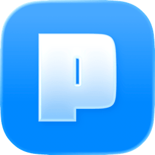

[English](README.md) | [简体中文](README.zh-CN.md) | Русский | [Українська](README.uk.md) | [العربية](README.ar.md) | [Türkçe](README.tr.md)

<div align="center">

  

  <h1>Purge</h1>

  <p><b>Освободите место на Mac. Безопасно.</b></p>

  <p>
    Бесплатное нативное приложение для Mac с открытым кодом, которое убирает кэш и мусор,<br/>
    накопившийся без вашего участия. Файлы по умолчанию отправляются в Корзину, так что их можно вернуть.
  </p>

<p>
  <a href="https://purgemac.com"></a>
  <a href="https://github.com/jithin-sabu/purge-app/actions/workflows/build.yml"></a>
  <a href="https://github.com/jithin-sabu/purge-app/blob/main/LICENSE"></a>
  <a href="https://github.com/jithin-sabu/purge-app/releases/latest"></a>
  <a href="https://github.com/jithin-sabu/purge-app/releases"></a>
  <a href="https://github.com/jithin-sabu/purge-app/stargazers"></a>
</p>

<p>
  <a href="https://trendshift.io/repositories/64435" target="_blank"><picture><source media="(prefers-color-scheme: dark)" srcset="https://trendshift.io/api/badge/repositories/64435?theme=dark"></picture></a>
</p>

  <p>
    <a href="https://github.com/jithin-sabu/purge-app/releases/latest"><b>Скачать</b></a>
    &nbsp;·&nbsp;
    <a href="#установка">Инструкция по установке</a>
    &nbsp;·&nbsp;
    <a href="#сборка-из-исходников">Сборка из исходников</a>
    &nbsp;·&nbsp;
    <a href="#безопасность">Безопасность</a>
  </p>

  

</div>

---

Ваш Mac тихо заполняется кэшем и мусором, которого вы не видите и не просили. Purge находит его, помечает то, что безопасно, и убирает одним щелчком. Файлы отправляются в Корзину, так что их можно вернуть.

## Установка

Purge работает на macOS 13 и новее.

**Через Homebrew**

```bash
brew install --cask purge
```

**Или скачайте вручную**

1. Скачайте `.dmg` из [последнего релиза](https://github.com/jithin-sabu/purge-app/releases/latest).
2. Откройте его и перетащите Purge в «Программы».
3. Откройте Purge. Приложение нотариально заверено Apple, поэтому открывается без лишних шагов.

<details>
<summary>Проверить загрузку (необязательно)</summary>

У каждого релиза есть файл `.dmg.sha256`. Скачайте его в ту же папку, что и `.dmg`, и выполните:

```bash
cd ~/Downloads
shasum -a 256 -c Purgev*.dmg.sha256
```

Если результат заканчивается на `OK`, файл в точности совпадает с опубликованным.

</details>

**«Полный доступ к диску» не обязателен.** Без него Purge сканирует кэши приложений и инструменты разработчика. С ним Purge находит ещё кэши приложений из App Store, большие файлы, установленные приложения и остатки удалённых приложений. Purge спросит об этом в конце первого запуска, а выключить доступ можно в любой момент в Системных настройках.

## Возможности

- **Обзор**: куда ушло место на диске, и все элементы «Безопасно очистить» отправляются в Корзину за один раз
- **Кэши приложений**: кэши приложений, журналы, отчёты о сбоях и оставшиеся установщики macOS
- **Инструменты разработчика**: кэши Xcode, Homebrew, npm, Docker и других, симуляторы и папки сборки вроде `node_modules` в проектах, с которыми вы больше не работаете
- **Большие файлы**: большие файлы, дубликаты, виртуальные машины и локальные модели ИИ, с Quick Look перед удалением
- **Удаление приложений**: удаляет приложение вместе с его кэшами, настройками и прочими остатками
- **Очистка по расписанию**: убирает элементы «Безопасно очистить» раз в неделю, раз в месяц или по вашему расписанию
- **Строка меню, Быстрые команды и Finder**: необязательный значок в строке меню, действия для Быстрых команд и пункт «Удалить с помощью Purge» в контекстном меню Finder
- **Пять языков**: английский, упрощённый китайский, русский, турецкий и арабский

Каждая функция, настройка и сочетание клавиш описаны на странице [Purge in detail](docs/features.md) (на английском).

## Безопасность

Purge удаляет файлы, поэтому безопасность на первом месте.

- **Корзина по умолчанию.** Файлы и папки отправляются в Корзину, и Purge никогда её не опустошает. Немногое удаляется навсегда, и Purge говорит об этом там, где вы это выбираете: симуляторы iOS и их среды выполнения, Metal Toolchain для Xcode, локальные снимки Time Machine, модели Apple Intelligence и инструменты или приложения, которые вы решили удалить через их пакетный менеджер. [Полный список](docs/features.md#what-goes-to-the-trash-and-what-is-removed-for-good) (на английском).
- **Только по списку разрешённого.** Purge чистит только места из своего списка безопасных и не трогает то, чего не узнаёт. Все они перечислены на [странице безопасности](https://purgemac.com/safety/).
- **Метки, которые можно проверить.** Каждый элемент помечен как «Безопасно очистить» или «Сначала проверить» и снабжён объяснением простым языком. Очистка одним щелчком и по расписанию берёт только элементы «Безопасно очистить».
- **Помощник с правами root выключен по умолчанию.** Небольшой помощник, который работает от root и нужен для приложений, установленных администратором, выключен, пока вы его не включите. Его исходный код лежит в `PurgeHelper/`.
- **Конфиденциальность.** Purge работает только на вашем Mac и не использует ИИ. Единственное обращение к сети — ежедневная проверка обновлений, и её можно выключить.
- **Открытый код и подпись.** Вся логика удаления — в этом репозитории. Приложение нотариально заверено Apple, а любое обновление без подписи ключом разработчика Purge отклоняет.

Нашли путь, который Purge может удалить, хотя не должен? Сообщите об этом приватно, как описано в [SECURITY.md](SECURITY.md).

## Частые вопросы

**Можно ли отменить очистку?**
Да, для всего, что попало в Корзину: верните это из Корзины, пока не очистили её. **Настройки → Обновления и история → История очистки** показывает, что куда ушло. То, что удалено навсегда, вернуть нельзя, но часть этого Xcode и Purge могут скачать снова.

**Нужен ли Purge «Полный доступ к диску»?**
Нет. Без него доступны кэши приложений и инструменты разработчика. С ним — ещё большие файлы, удаление приложений и остатки.

**Как обновить Purge?**
Purge раз в день проверяет обновления и показывает список изменений, прежде чем что-то установить. В **Настройки → Обновления и история** можно включить автоматическую установку или выключить проверку. Если вы ставили через Homebrew, выполните `brew upgrade --cask purge`. [Подробнее об обновлении](docs/features.md#updating) (на английском).

**Отправляет ли Purge что-нибудь с моего Mac?**
Только запрос проверки обновлений, в котором есть версия Purge и ничего о вас или вашем Mac. [Подробнее о конфиденциальности](docs/features.md#privacy) (на английском).

**Как удалить Purge?**
Выберите **Удалить Purge…** в меню Purge. Purge выключит всё, что запускает в фоне, и переместит себя в Корзину. [Подробнее об удалении](docs/features.md#uninstalling) (на английском).

## Сборка из исходников

Понадобятся macOS 13 или новее и Xcode 26 или новее.

```bash
git clone https://github.com/jithin-sabu/purge-app.git
cd purge-app
open purge.xcodeproj
```

Выберите схему **purge** и нажмите **⌘R**. В **Signing & Capabilities** выберите свою команду или **Sign to Run Locally**. Сборка и тесты из командной строки описаны в [CONTRIBUTING.md](CONTRIBUTING.md#building-and-testing) (на английском).

## Участие в проекте

Сообщения об ошибках, находки по безопасности и пул-реквесты приветствуются. Начните с [CONTRIBUTING.md](CONTRIBUTING.md). Изменения в том, что Purge может удалить, проверяются строже, и это сделано намеренно.

## Лицензия

MIT. См. [LICENSE](LICENSE).

## Поддержка

Purge бесплатен. Если он сэкономил вам место, можно помочь из экрана **О программе** в приложении или через [Buy Me a Coffee](https://buymeacoffee.com/jithinsabu).

<div align="center">

<a href="https://buymeacoffee.com/jithinsabu"></a>

</div>

---

<div align="center">

**Jithin Sabu**

<a href="https://jithinsabu.com"></a>
<a href="https://linkedin.com/in/jithinsabu"></a>
<a href="https://x.com/sabu_jithin"></a>
<a href="mailto:jithin@purgemac.com"></a>


</div>
