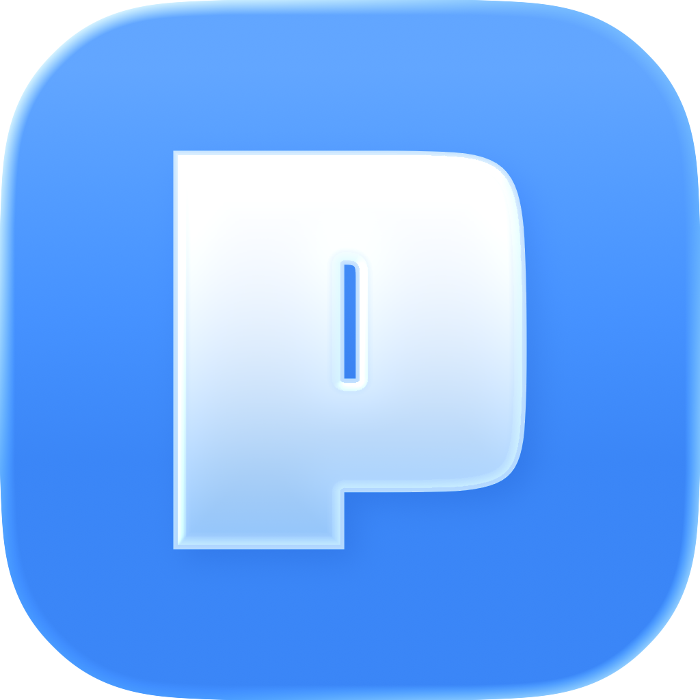
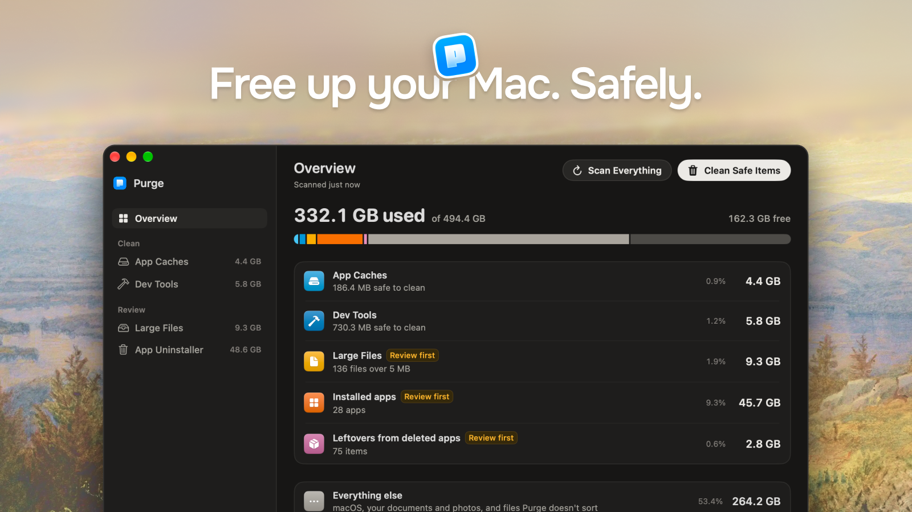

[English](README.md) | [简体中文](README.zh-CN.md) | [Русский](README.ru.md) | Українська

<div align="center">

  

  <h1>Purge</h1>

  <p><b>Звільніть місце на Mac. Безпечно.</b></p>

  <p>
    Безкоштовний нативний застосунок для Mac з відкритим кодом, який прибирає кеш і сміття,<br/>
    що накопичуються на Mac самі собою. Файли за замовчуванням потрапляють у Кошик, тож їх можна повернути.
  </p>

<p>
  <a href="https://github.com/jithin-sabu/purge-app/actions/workflows/build.yml"></a>
  <a href="https://github.com/jithin-sabu/purge-app/blob/main/LICENSE"></a>
  <a href="https://github.com/jithin-sabu/purge-app/releases/latest"></a>
  <a href="https://github.com/jithin-sabu/purge-app/releases"></a>
  <a href="https://github.com/jithin-sabu/purge-app/stargazers"></a>
</p>

<p>
  <a href="https://trendshift.io/repositories/64435" target="_blank"><picture><source media="(prefers-color-scheme: dark)" srcset="https://trendshift.io/api/badge/repositories/64435?theme=dark"></picture></a>
</p>

  <p>
    <a href="https://github.com/jithin-sabu/purge-app/releases/latest"><b>Завантажити</b></a>
    &nbsp;·&nbsp;
    <a href="#встановлення">Інструкція зі встановлення</a>
    &nbsp;·&nbsp;
    <a href="#збирання-з-вихідного-коду">Збирання з вихідного коду</a>
    &nbsp;·&nbsp;
    <a href="#безпека">Безпека</a>
  </p>

  

</div>

---

Ваш Mac непомітно заповнюється кешем і сміттям, яких ви не бачите й про які не просили. Purge знаходить їх, позначає, що безпечно видаляти, і прибирає одним клацанням.

> [!NOTE]
> Файли й папки за замовчуванням переміщуються в Кошик, а Purge ніколи його не очищує, тож їх можна повернути, доки ви самі не очистите Кошик. Назавжди видаляються: симулятори iOS і середовища виконання симуляторів — через `simctl` з Xcode; необов'язковий Metal Toolchain для Xcode — через `xcodebuild -deleteComponent` (Xcode завантажить його знову, коли він знадобиться проєкту); локальні знімки Time Machine — через `tmutil` (Purge залишає найновіший і той, що з вашої останньої резервної копії); моделі Apple Intelligence на macOS 27, які вивільняє служба ресурсів Apple і які Purge може завантажити знову; інструменти командного рядка та застосунки з cask Homebrew, які видаляє їхній менеджер пакетів, якщо ви оберете це у вікні перевірки. Папка Docker Desktop переміщується в Кошик. `docker system prune` Purge не запускає.

Щоб користуватися застосунком, розбиратися в усьому цьому не потрібно. Але якщо захочете перевірити, кожен елемент має пояснення простою мовою та мітку безпеки, тож ніщо не буде зачеплено, поки ви не побачите й не перевірите це самі.

> [!NOTE]
> Інтерфейс Purge поки що доступний англійською, спрощеною китайською, російською та турецькою мовами, тож на Mac з українською мовою системи застосунок буде англійською. Тому назви кнопок, вкладок і пунктів меню тут залишено англійською — так, як ви побачите їх у застосунку. Якщо цей текст десь розходиться з англійським README, правильним є англійський.

---

## Можливості

### Огляд (Overview)

- **Куди поділося місце**: одна смуга на весь диск. Зайняте, вільне й загальне місце беруться безпосередньо з тому, тож збігаються із Системними параметрами. App Caches, Dev Tools, Large Files, встановлені застосунки й залишки видалених застосунків мають кожен свій сегмент, а решта показана як «усе інше»
- Рядок для кожної категорії з її розміром і часткою диска. Клацніть рядок, щоб відкрити відповідну вкладку
- **Everything else** («усе інше») теж відкривається. Клацніть рядок — і сторінка покаже, що там: чотири цифри про те, що можна зробити з цим місцем, над мапою, де кожна група — це рамка з найбільшими папками всередині, за розміром і з кольором за типом. Типи такі: місце, яке звільняється в іншому застосунку (Фотографії, Пошта, Steam, Кошик), ваші власні файли (проєкти, документи), те, що Purge не чіпає, бо не вважає безпечним для видалення (кеші не з його списку, дані застосунків, які не належать жодному встановленому застосунку), і те, чим керує macOS. Наведіть на плитку, щоб побачити назву, і клацніть, щоб дізнатися, що це, з кнопкою Show in Finder або власним способом застосунку-власника звільнити місце. Сторінка лише для перегляду: ніщо на ній не переміщує файли
- **Scan Everything** (⇧⌘R) сканує всі категорії по черзі, щоб Mac не гальмував. Коли ви відкриваєте Purge, він робить це сам. Для Large Files, списку застосунків і залишків потрібен «Повний доступ до диска». Без нього Purge однаково сканує App Caches і Dev Tools та пропускає місця, які захищає macOS, наприклад кеші застосунків у пісочниці
- Кожен байт рахується один раз: папка кешу застосунку рахується в App Caches, а не ще раз у самому застосунку
- **Hidden in System Data** («сховане в системних даних»): картка під категоріями для місця, яке macOS зараховує до системних даних. У її рядку **Time Machine snapshots** видаляються локальні знімки, а на macOS 27 там же є моделі Apple Intelligence
- **Моделі Apple Intelligence** (macOS 27, Apple silicon): моделі на пристрої, які macOS записує до системних даних і для яких немає перемикача, щоб їх видалити. Remove вивільняє їх через службу ресурсів Apple і встановлює профіль, який ви схвалюєте один раз, щоб вони не завантажувалися знову. Download Again просить вас видалити профіль у Системних параметрах, а потім запитує в macOS набори, які видалив Purge, мовою вашої Siri. Показаний розмір — це цифра Apple; Purge записує, скільки диск звільнив насправді

### Кеші застосунків (App Caches)

Сканує `~/Library/Caches`, кеші контейнерів пісочниці (для них потрібен «Повний доступ до диска») і поширене системне сміття:

- Папки кешу кожного застосунку зі зрозумілими назвами, іконками брендів і поясненням простою мовою, якщо захочете його прочитати
- System Junk: журнали застосунків, звіти про збої, інсталятори macOS і залишки файлів оновлень macOS
- Великі медіакеші творчих застосунків, як-от Premiere Pro та After Effects
- Кілька розташувань кешу одного застосунку об'єднано в один рядок
- Результати з'являються одразу, щойно їх знайдено

### Інструменти розробника (Dev Tools)

П'ять груп в одному вікні:

- **Глобальні кеші інструментів розробника**: Xcode (Derived Data, Archives, DeviceSupport), Homebrew, npm, pnpm, Yarn, CocoaPods, Gradle, кеш pub для Dart і Flutter, Docker Desktop, VS Code, Cursor, JetBrains, Cargo, Terraform тощо
- **Симулятори iOS**: кожен вимкнений симулятор, по рядку на кожен. Запущений симулятор показано, щоб його місце врахувалося, але вибрати його не можна
- **Середовища виконання симуляторів**: рядок для кожного середовища, яке `simctl` позначає як придатне до видалення
- **Компоненти Xcode**: необов'язковий Metal Toolchain для Xcode (близько 900 МБ), який видаляється через `xcodebuild -deleteComponent`, коли повний Xcode показує його як встановлений
- **Проєкти розробника**: `node_modules`, віртуальні середовища Python, `target` у Rust, результати збирання Flutter, `Pods` у Xcode, `.gradle` в Android та інші артефакти, згруповані за проєктами

Симулятори, середовища виконання й компоненти Xcode завжди мають мітку Check First. Вони видаляються назавжди, а не переміщуються в Кошик, і заголовки їхніх розділів про це кажуть.

У **Settings → Cleaning** параметр **Projects count as stale after** (від 1 місяця до 2 років або Show all) визначає, які проєкти з'являються у списку. Вік рахується від останньої зміни будь-чого в проєкті, зокрема активності git, а не від дати `node_modules` чи `target`. Проєкт, з яким ви працюєте просто зараз — у ньому відкритий термінал або запущений dev-сервер, чи виконується команда git, — у списку ніколи не з'являється.

Робочі дерева git (worktrees), створені ШІ-інструментами для програмування (Cursor, Codex, Conductor, T3 Code і Claude Code), з'являються в **Orphaned Git Worktrees** лише тоді, коли їхній репозиторій їх більше не вказує. Робоче дерево, яким git ще користується, не з'являється, хоч би яким старим воно було, як і те, в якому працює термінал чи агент.

### Великі файли (Large Files)

Знаходьте особисті файли, що займають багато місця, не перекопуючи папки вручну:

- Сканує **Документи**, **Робочий стіл**, **Завантаження**, **Фільми**, **Музика** і **Зображення**, а також `~/Parallels` і `~/Virtual Machines.localized` — лише для віртуальних машин, і власну папку iCloud Drive — для файлів, які можна залишити тільки в iCloud
- Папку, яку ви перенесли й замінили посиланням (наприклад, `~/Documents` вказує на інший диск), Purge сканує там, куди веде посилання, якщо це всередині вашої домашньої папки або на диску в `/Volumes`, підключеному до вашого Mac. Її файли показано за їхнім справжнім шляхом, і вони потрапляють у Кошик того диска. За посиланням будь-куди ще — наприклад, у `~/Library/CloudStorage`, на мережевий ресурс, на цілий диск чи копію Mac — Purge не переходить, а сканування показує, куди воно веде. За посиланнями всередині папок Purge не переходить ніколи
- Пропускає керовані медіатеки (Фотографії, iMovie, Музика тощо), приховані папки та папки проєктів, як-от `node_modules`, `Pods`, `DerivedData` і результати збирання. Видалення одного файлу з дерева залежностей лише ламає встановлення, тому такі папки належать до Dev Tools, де вони видаляються цілком
- **Пошук** фільтрує список під час введення: за назвою файлу, папкою, в якій він лежить, і міткою джерела
- Фільтр за **розміром** (від 5 МБ до 1 ГБ) і **останнім використанням** (від будь-коли до понад рік тому)
- Чипи категорій: відео, аудіо, зображення, PDF, архіви, документи, моделі ШІ, віртуальні машини та інші файли
- **Дублікати**: побайтове порівняння знаходить ідентичні копії, групує їх і показує, скільки місця звільниться, якщо залишити одну. Чип **Duplicates** збирає їх в одному місці. **Delete extra copies** очищує цілу вкладку дублікатів за раз: для кожного набору пропонує копію, яку варто залишити, а решту позначає для Кошика, і перед видаленням ви можете вибрати іншу копію. Нічого не видаляється, доки ви не переглянете й не підтвердите
- Сортування за розміром, датою або назвою; виберіть файли й перегляньте їх перед видаленням
- **Quick Look** і **Show in Finder** з кожного рядка
- Видалені файли переміщуються в **Кошик**, тож нічого не стирається назавжди
- **Keep Only in iCloud** звільняє місце, яке файл з iCloud займає на цьому Mac, і залишає файл в iCloud — так само, як команда Remove Download у Finder. Чип **iCloud** показує синхронізовані файли, які також займають місце тут, і скільки ви звільните; дія є там і в контекстному меню кожного синхронізованого файлу. Файл лишається у своїй папці у Finder з позначкою хмари, а якщо його відкрити, він завантажиться знову. Purge пропонує це лише для файлів, повністю вивантажених в iCloud, без конфлікту синхронізації, без налаштування Keep Downloaded, без жорстких посилань і незмінених протягом п'яти хвилин. Безпосередньо перед дією з кожним файлом він перевіряє все це ще раз і пропускає файли, відкриті в якомусь застосунку. Файли з власної папки iCloud Drive ніколи не пропонуються для Кошика, бо переміщення в Кошик видаляє їх і з ваших інших пристроїв. Ця дія ніколи не входить до Clean Safe Items чи очищення за розкладом

Large Files не стосується очищення кешу: це ваші особисті файли, а не кеші, які можна відтворити.

#### Образи відновлення, віртуальні машини й незавершені завантаження

Деякі великі файли мають мітку, яка каже, що це. Наведіть на неї, щоб побачити повне пояснення.

- **Образ відновлення**: файл macOS `.ipsw`, часто 15–25 ГБ. Він потрібен лише для налаштування Mac, пристрою або віртуальної машини.
- **Віртуальна машина**: пакет Parallels (`.pvm`), UTM (`.utm`) або VMware Fusion (`.vmwarevm`). Це один рядок, і в Кошик він потрапляє цілим, ніколи не окремий файл диска зсередини. Якщо застосунок ще встановлено, мітка радить видалити віртуальну машину в ньому, бо застосунок веде власний список. Віртуальна машина, застосунок якої відкритий або яка має файл блокування, не з'являється у списку, доки ви не закриєте застосунок.
- **Незавершене завантаження**: файли `.crdownload`, `.part` і `.prlupd-part` від Parallels, а також пакет `.download` від Safari, якщо він лежить безпосередньо в «Завантаженнях».

#### Локальні моделі ШІ

Завантажені моделі часто є найбільшими файлами на Mac, і про них легко забути. Вони з'являються в Large Files у категорії **AI Models**, по рядку на модель, з тією назвою, під якою ви її встановили, а розташуванням указано застосунок чи бібліотеку, що її завантажили. Purge знає сховища **Ollama**, **LM Studio**, кешу **Hugging Face Hub** (`~/.cache/huggingface/hub`; `HF_HOME` і `HF_HUB_CACHE` враховуються, коли їх задано для застосунків, а не лише в профілі оболонки), swift-transformers, застосунків, що зберігають моделі в `~/Library/Caches/huggingface`, **PyTorch Hub**, **Whisper**, **GPT4All**, **Jan**, **DiffusionBee** і **Draw Things**. Файли ваг понад 100 МБ у `~/Library/Caches`, `~/Library/Application Support` і `~/.cache`, які не належать жодному відомому сховищу, теж показано — за папкою, в якій вони лежать, щоб ви могли зрозуміти, який застосунок їх завантажив.

Purge розуміє адресоване за вмістом сховище Ollama, тож розмір моделі враховує лише ті байти, які справді звільняться, а не блоби, спільні з іншою моделлю. Модель Hugging Face — це вся її папка в кеші, тож блоб, спільний для двох знімків, рахується один раз і ніколи не видаляється з-під іншого. Моделі завжди потрапляють у Кошик і ніколи не входять до Clean Safe Items чи очищення за розкладом. Коли застосунок веде власний список встановлених моделей, який Purge не може оновити, у рядку сказано, що застосунок може й далі показувати модель як встановлену.

### Видалення застосунків (App Uninstaller)

Якщо перетягнути застосунок у Кошик, більша його частина лишається: кеші, налаштування, контейнери, збережений стан, журнали, cookie та дані вебсайтів, а також помічники входу накопичуються на диску. Uninstaller видаляє застосунок разом із цими залишками за один прохід.

- Показує застосунки, які ви встановили в **Програми** (`/Applications`) і **~/Applications**, у папці **Applications** на верхньому рівні будь-якого підключеного диска та в папках, які ви додали в Settings > Where Purge looks for apps (або з підказки під списком застосунків), пропускаючи системні застосунки й сам Purge. Кожна плитка показує, скільки звільнить видалення: пакет застосунку плюс залишки, які Purge з ним зіставив
- Застосунки одного розробника, що мають спільну папку, як-от чотири застосунки в `/Applications/DaVinci Resolve`, показано одним записом, який розгортається до своїх застосунків
- Виберіть один або кілька застосунків, а потім перегляньте вікно з розділом для кожного застосунку, де показано кожен елемент із шляхом і розміром
- Зіставлення суворе, тож видалення одного застосунку не захопить файли, спільні для кількох застосунків розробника. Кожен збіг приходить позначеним, а ви знімаєте позначку з того, що хочете залишити. Три види спочатку не позначено: прихована папка у вашій домашній папці з налаштуваннями застосунку, папка Application Scripts зі скриптами всередині та все, чим ще користується інший встановлений застосунок, — таке утримується й позначається «Kept, still used by» з назвою того застосунку
- Запущений застосунок спочатку просять завершити роботу, і лише коректно. Якщо він відмовляється, його залишають встановленим, а решта набору все одно обробляється
- Усе підтверджене переміщується в **Кошик** тим самим механізмом видалення, що й решта Purge, тож усе можна повернути. Єдиний виняток — застосунок, який Homebrew встановив як cask: вікно перевірки пропонує дві кнопки, Remove with Homebrew і Move All to Trash, і попереджає, що Homebrew видаляє застосунок назавжди й виконує власні кроки видалення cask, які можуть зупинити його фонові служби та також назавжди видалити його допоміжні інструменти й файли інсталятора. Cask, який встановлює кілька застосунків, ніколи не пропонується для Homebrew. Його залишки все одно потрапляють у Кошик, а якщо Homebrew відмовить, застосунок натомість піде в Кошик
- Необов'язково, вимкнено за замовчуванням: увімкніть **Review leftovers when an app is deleted** у Settings. Тоді невеликий фоновий спостерігач помічає, коли застосунок зникає з однієї з цих папок — навіть якщо Purge закрито, — відкриває Purge лише із залишками цього застосунку й не заважає після того, як ви підтвердите або відхилите. Без такої перевірки нічого не переміщується. Тут позначеними приходять лише точні збіги за bundle id і групою застосунків у вашій домашній папці; менш точні збіги лише за назвою приходять непозначеними, щоб ви їх підтвердили
- Деякі застосунки встановлено від імені адміністратора, тому ваш обліковий запис не може перемістити їх у Кошик; те саме стосується їхніх залишків у `/Library`. Увімкніть **Remove admin-locked apps without a password** у Settings, і невеликий помічник, що працює від root, перемістить їх у ваш Кошик. Він переміщує лише шляхи, схвалені засобом видалення, і залишки файлів оновлень macOS. На стандартному обліковому записі цей параметр називається **Remove admin-locked apps**, і Purge щоразу просить ім'я та пароль адміністратора
- Почати можна й із Finder: увімкніть **Uninstall from Finder's right-click menu** у Settings, потім клацніть застосунок правою кнопкою й виберіть **Uninstall with Purge**. Те саме відбувається, якщо перетягнути застосунок на іконку Purge у Dock

Uninstaller має ще два списки поряд з **Installed Apps**. Кожен з'являється, коли його сканування щось знаходить:

- **Leftovers**: файли, що лишилися від уже видалених застосунків, згруповані за тим, як Purge зіставив їх із застосунком. Нічого не вибрано за вас
- **Command-Line Tools**: інструменти, встановлені скриптом, потрапляють у Кошик: папка інструмента у вашій домашній папці, команди в `~/.local/bin`, що його запускають, і його фонові завдання. Інструменти, встановлені через Homebrew, npm, pipx, uv або Cargo, видаляються власною командою видалення відповідного менеджера, назавжди. Вікно підтвердження показує ці дві групи окремо

### Мітки безпеки

Purge присвоює мітку безпеки кожному елементу, який розпізнає:

| Мітка | Значення |
|-------|---------|
| ✅ **Safe to Clean** | Відомий кеш або артефакт, який можна відтворити; безпечно видаляти |
| ⚠️ **Check First** | Може бути безпечним, але видалення може завдати незручностей |

Фільтруйте за **All**, **Safe to Clean** або **Check First** (⌥⌘1–⌥⌘3). Сортуйте за розміром, датою зміни або назвою.

Нерозпізнані папки взагалі не потрапляють у список. Purge показує лише те, про що знає.

Мітки й пояснення існують для того, щоб їх перевіряти, а не читати від початку до кінця. Виберіть безпечні елементи й очистьте їх або спершу відкрийте пояснення до будь-якого рядка. Обидва способи годяться.

### Очищення

- **Clean Selected**: виберіть конкретні рядки, перегляньте їх у вікні підтвердження, потім видаліть. Перевірки git і lock-файлів виконуються до того, як щось буде видалено
- **Clean Safe Items**: на Overview переміщує всі елементи Safe to Clean у Кошик після одного підтвердження
- **Clean Safe Files**: те саме безпечне очищення з рядка меню
- **Очищення за розкладом**: у **Settings → Cleaning** увімкніть **Clean automatically** і виберіть частоту (щотижня, щомісяця, раз на 3 місяці або **Custom** — власний інтервал у днях, тижнях чи місяцях). Purge надсилає локальне нагадування, коли настає час очищення, і виконує його наступного разу, коли ви відкриєте Purge або перейдете до нього, тож очищення відбувається без вашої участі. У фоні він ніколи не очищує
- Файли й папки переміщуються в **Кошик**. Purge ніколи не очищує Кошик. Симулятори iOS і середовища виконання симуляторів видаляються назавжди через `simctl` з Xcode. Metal Toolchain видаляється назавжди через `xcodebuild -deleteComponent`, і Xcode завантажує його знову, коли він потрібен проєкту. Локальні знімки Time Machine видаляються назавжди через `tmutil`; Purge залишає найновіший і той, що з вашої останньої резервної копії. Моделі Apple Intelligence вивільняються через службу ресурсів Apple, і їх можна завантажити знову. Інструменти та застосунки з cask, встановлені менеджером пакетів, видаляються власною командою видалення цього менеджера, назавжди, якщо ви оберете це у вікні перевірки

### Налаштування (Settings)

Settings — це вкладка на бічній панелі (⌘,) з п'ятьма групами:

- **General**: **Keep Purge in the menu bar**, вимкнено в новому встановленні. Коли параметр увімкнено, Purge працює й після закриття вікна, і також можна вибрати **Launch Purge at login** і **Hide Dock icon**. **Appearance**: Auto, Light або Dark
- **Cleaning**: **Clean automatically** із частотою й датою наступного очищення. **Projects count as stale after** — поріг для проєктів розробника. **Excluded folders** — папки, які ви попросили Purge не чіпати, кожна з поточним розміром. Щоб додати папку, клацніть правою кнопкою рядок в App Caches, Dev Tools чи Large Files і виберіть **Exclude from scans**. Виключене середовище виконання симулятора показано за назвою та збіркою, з розміром, який воно мало на момент виключення. Виключення лише звужує те, що переглядає Purge
- **Uninstalling**: **Uninstall from Finder's right-click menu**, **Where Purge looks for apps**, **Review leftovers when an app is deleted** і **Remove admin-locked apps without a password**
- **Updates and History**: **Check for updates automatically**, **Install updates automatically** і **Cleaning history** — список кожного автоматичного й ручного очищення зі звільненим місцем і кількістю елементів, а також підсумок останнього. Відкрийте очищення, щоб побачити, що перемістилося в Кошик, що видалено назавжди, а що пропущено
- **Uninstall**: **Uninstall Purge**, про це в розділі [Видалення Purge](#видалення-purge)

### Інше

- **Знайомство під час першого запуску**: привітання, перше сканування й результати з кнопкою, яка переміщує безпечні елементи в Кошик. Наостанок — необов'язковий запит на «Повний доступ до диска», який з'являється, лише якщо в Purge його немає
- **Помічник у рядку меню**: доступне для звільнення місце з першого погляду, швидке відкриття, сканування й очищення. Він необов'язковий і вимкнений у новому встановленні; увімкніть **Keep Purge in the menu bar** у Settings
- **Швидкі команди й Spotlight**: три дії — Scan for Junk, Clean Safe Junk і Uninstall an App
- **Мови**: застосунок доступний англійською, спрощеною китайською, російською й турецькою та використовує мову системи
- **Зведення про диск**: Overview показує зайняте й вільне місце; бічна панель — що вже лежить у Кошику і розмір кожної вкладки сканування
- **Оновлення в застосунку**: екран About перевіряє, завантажує й встановлює нові версії

### Сполучення клавіш

| Сполучення | Дія |
|----------|--------|
| ⌘R | Сканувати поточну вкладку (на Overview — Scan Everything) |
| ⇧⌘R | Scan Everything з будь-якої вкладки |
| ⌘1–⌘5 | Перейти до Overview, App Caches, Dev Tools, Large Files або App Uninstaller |
| ⌥⌘1–⌥⌘3 | Фільтр All, Safe to Clean або Check First в App Caches і Dev Tools |
| ⌘F | Пошук у Large Files і App Uninstaller |
| ⌘, | Відкрити Settings |

---

## Завантажити

<div align="center">

<a href="https://github.com/jithin-sabu/purge-app/releases/latest"></a>

</div>

---

## Встановлення

Встановити Purge можна двома способами: через Homebrew, якщо ви живете в терміналі, або завантаживши застосунок напряму. Обидва дають той самий результат.

### Встановлення через Homebrew

```bash
brew install --cask purge
```

Ця команда встановлює Purge з офіційного cask Homebrew, і Homebrew автоматично перевіряє контрольну суму завантаження.

### Встановлення вручну

Нижче описано кроки для прямого завантаження.

#### Крок 1. Завантаження

Клацніть посилання для завантаження вище й завантажте файл `.dmg`.

#### Крок 2. Перевірка завантаження (необов'язково, але рекомендовано)

> [!TIP]
> Оскільки Purge видаляє файли, перевірка контрольної суми підтверджує, що ваше завантаження байт у байт збігається з опублікованим і нічого не змінилося дорогою.

До кожного релізу додано відповідний файл контрольної суми `.dmg.sha256`. Завантажте `.dmg` і його файл `.dmg.sha256` в одну папку, а потім виконайте в Терміналі:

```bash
cd ~/Downloads
shasum -a 256 -c Purgev*.dmg.sha256
```

Результат, що закінчується на `OK`, означає, що файл збігається з опублікованим релізом.

#### Крок 3. Встановлення

Відкрийте `.dmg` і перетягніть Purge у папку «Програми».

#### Крок 4. Запуск Purge

Двічі клацніть Purge, щоб відкрити його. Purge нотаризовано Apple, тож він відкривається звичайно, без додаткових кроків.

#### Крок 5. Дозвольте Purge зазирнути глибше (необов'язково)

Purge працює і без «Повного доступу до диска»: він сканує App Caches і Dev Tools. З ним Purge також знаходить кеші застосунків з App Store, великі файли, встановлені застосунки й залишки видалених застосунків.

1. Наприкінці першого запуску або пізніше з **Look deeper** клацніть **Let Purge in**. Відкриються Системні параметри
2. Знайдіть Purge у списку й увімкніть його перемикач
3. Поверніться до Purge. Він сам помітить зміну. Якщо macOS запропонує перезапустити Purge, погодьтеся

Виберіть **Not now**, щоб пропустити цей крок. Доступ можна будь-коли вимкнути в Системних параметрах.

---

## Оновлення

Purge оновлюється сам. Раз на день він перевіряє, чи є нова версія, і якщо є, з'являється вікно оновлення з примітками до релізу. Виберіть **Install Update**, і Purge завантажить оновлення, перевірить його підпис, встановить і перезапуститься. Не потрібно заходити на сторінку релізу чи щось перетягувати.

За замовчуванням нічого не встановлюється без вашого підтвердження. Перевірити оновлення можна будь-коли на екрані **About**, а якщо ви не хочете, щоб Purge перевіряв сам, вимкніть **Check for updates automatically** у **Settings → Updates and History**.

Якщо не хочете, щоб вас питали, увімкніть **Install updates automatically** там само або поставте відповідну позначку у вікні оновлення. Тоді нові версії завантажуються у фоні й встановлюються, коли Purge наступного разу завершить роботу. Коли оновлення готове, **Restart to Update** у меню Purge, у меню в рядку меню або на екрані **About** одразу його встановить. Це зручно, якщо Purge живе в рядку меню і ви рідко його закриваєте.

Оновлення доставляються через [Sparkle](https://sparkle-project.org) — стандартний фреймворк оновлень для застосунків Mac поза App Store. Кожне оновлення підписано ключем, який зберігається лише на комп'ютері розробника, і Purge відхиляє будь-яке завантаження без відповідного підпису.

### Оновлення через Homebrew

Якщо ви встановили Purge через Homebrew, оновити його можна й з термінала:

```bash
brew upgrade --cask purge
```

Підходить будь-який спосіб. Ваші налаштування, розклад очищення й історія зберігаються, хоч як ви оновлюєтеся: вони лежать окремо від застосунку. «Повний доступ до диска» теж не доведеться надавати знову, бо дозвіл лишається за Purge.

Попередні версії можна будь-коли переглянути на [сторінці релізів](https://github.com/jithin-sabu/purge-app/releases).


---

## Видалення Purge

Виберіть **Uninstall Purge…** у меню Purge або **Settings → Uninstall → Uninstall…**. Purge покаже, що він запускає у фоні на вашому Mac (спостерігач за видаленими застосунками, помічник адміністратора, пункт у контекстному меню Finder, нагадування про очищення та запуск під час входу), вимкне кожне з них і перевірить, що воно справді зупинилося, а потім перемістить себе в Кошик і завершить роботу.

Ваші налаштування й історія очищень лишаються на Mac, тож після повторного встановлення ви продовжите з того самого місця. Позначте **Also move settings and history to the Trash**, щоб перемістити в Кошик і їх. Нічого не видаляється назавжди; Кошик ви очищаєте самі, коли будете готові.

macOS не дозволяє застосунку самому забрати в себе «Повний доступ до диска». Якщо Purge його мав, останній екран запропонує **Quit and Open Full Disk Access**. У Системних параметрах виберіть Purge і клацніть кнопку «мінус».

Уже перетягнули Purge у Кошик? Завантажте його знову, відкрийте й виберіть **Uninstall Purge…**, щоб ніщо із запущеного ним не продовжувало працювати. Щоб перевірити, що нічого не лишилося: Purge має зникнути з **Системні параметри → Загальні → Об'єкти входу та розширення**, а ця команда не повинна нічого вивести:

```bash
pgrep -fl io.getpurge
```


---

## Збирання з вихідного коду

Хочете зібрати Purge самі замість завантаження релізу? Ось як.

### Що потрібно

- macOS 13.0 або новіша
- **Xcode 26 або новіший** (з Mac App Store). Проєкт використовує налаштування збирання Swift 6.2 (default actor isolation і approachable concurrency) та `@concurrent`, для яких потрібен Xcode 26; давніші версії його не зберуть
- [Node.js](https://nodejs.org) 18+ і npm — лише якщо ви хочете перегенерувати іконки брендів

Залежності розв'язує Swift Package Manager під час першого збирання. Залежність лише одна — [Sparkle](https://github.com/sparkle-project/Sparkle), який відповідає за оновлення в застосунку.

### Крок 1. Клонуйте репозиторій

```bash
git clone https://github.com/jithin-sabu/purge-app.git
cd purge-app
```

### Крок 2. Зберіть і запустіть

Відкрийте проєкт у Xcode й запустіть:

```bash
open purge.xcodeproj
```

Потім виберіть схему **purge** і натисніть **⌘R**.

Проєкт налаштовано на підписування сертифікатом Developer ID розробника, якого у вас не буде. У Xcode відкрийте **Signing & Capabilities** для кожної цілі й виберіть власну команду або **Sign to Run Locally**.

Або зберіть просто з командного рядка, вимкнувши підписування:

```bash
# Зібрати Debug-версію
xcodebuild -project purge.xcodeproj -scheme purge -configuration Debug build CODE_SIGN_IDENTITY="" CODE_SIGNING_REQUIRED=NO CODE_SIGNING_ALLOWED=NO

# Зібрати Release-версію
xcodebuild -project purge.xcodeproj -scheme purge -configuration Release build CODE_SIGN_IDENTITY="" CODE_SIGNING_REQUIRED=NO CODE_SIGNING_ALLOWED=NO
```

Зібраний `Purge.app` записується в папку DerivedData Xcode (вивід збирання закінчується його шляхом). macOS вважає кожну збірку без вашого підпису новим застосунком, тож після перезбирання «Повний доступ до диска» доведеться надати знову.

### Необов'язково: перегенерувати іконки брендів

Іконки кешів застосунків генеруються з [simple-icons](https://simpleicons.org). Щоб перебудувати їх:

```bash
npm install
npm run generate:icons
```

### Запуск тестів

```bash
xcodebuild test -project purge.xcodeproj -scheme purge -destination 'platform=macOS' CODE_SIGN_IDENTITY="" CODE_SIGNING_REQUIRED=NO CODE_SIGNING_ALLOWED=NO
```

Прапорці підписування важливі: без сертифіката розробки на комп'ютері тестова збірка завершиться помилкою ще до запуску першого тесту. CI збирає так само.

---

## Системні вимоги

- macOS 13.0 або новіша
- «Повний доступ до диска» (необов'язково; потрібен для Large Files, App Uninstaller і залишків)
- Xcode (необов'язково, для симуляторів iOS і середовищ виконання симуляторів). Якщо ви видалили Xcode, Purge однаково знайде симулятори, які від нього лишилися

---

## Конфіденційність

Purge працює повністю на вашому Mac. Виключені папки, історія очищень і останнє сканування зберігаються в його папці Application Support, а налаштування — у його параметрах. Нічого не вивантажується. Останнє сканування зберігається, щоб Purge мав що показати, поки сканує знову. З «Робочого столу», «Документів», «Завантажень» чи iCloud туди нічого не записується, а Large Files зберігає лише підсумки за типами файлів, ніколи не назви файлів.

Єдиний раз, коли Purge звертається до мережі, — це перевірка оновлень: раз на день він завантажує з GitHub невеликий XML-файл, щоб дізнатися, чи є новіша версія. Він не надсилає нічого про вас чи ваш Mac, і цю перевірку можна вимкнути в **Settings → Updates and History**.

Purge читає вміст деяких файлів — лише на вашому Mac. Щоб знайти дублікати, він побайтово порівнює файли однакового розміру. Щоб визначити, якому застосунку чи інструменту належить файл, він читає невеликі файли, як-от `Info.plist` застосунку, plist-файли LaunchAgent і скрипти, що запускають інструменти командного рядка. Вміст файлів він нікуди не надсилає.

Purge не використовує ШІ. Нічого з того, що ви скануєте чи очищаєте, не надсилається до сервісів ШІ.

---

## Безпека

Purge видаляє файли, тож безпека — головне. Кілька речей, які варто знати:

- **Кошик за замовчуванням**: файли й папки переміщуються в Кошик macOS, і Purge ніколи його не очищує. Їх можна відновити, доки ви самі не очистите Кошик. Симулятори iOS і середовища виконання симуляторів видаляються назавжди через `simctl`. Metal Toolchain для Xcode видаляється назавжди через `xcodebuild -deleteComponent` і завантажується знову, коли потрібен проєкту. Локальні знімки Time Machine видаляються назавжди через `tmutil`; Purge залишає найновіший і той, що з вашої останньої резервної копії. Моделі Apple Intelligence вивільняються через службу ресурсів Apple, і їх можна завантажити знову з Purge. Інструменти командного рядка й застосунки з cask Homebrew, які ви вирішили видалити через їхній менеджер пакетів, видаляє цей менеджер, назавжди. Папка даних Docker Desktop потрапляє в Кошик. `docker system prune` Purge не запускає.
- **Видалення за списком дозволених шляхів**: до очищення придатні лише шляхи, що відповідають явному списку дозволених. Усього, що Purge не розпізнає, він не чіпає. На [сторінці безпеки](https://purgemac.com/safety) перелічено всі дозволені розташування та все, чого Purge ніколи не чіпатиме; її згенеровано з вихідного коду застосунку.
- **Ви вирішуєте, що видаляти**: Purge показує, що можна звільнити, а ви вирішуєте, що прибрати.
- **Помічник root, вимкнений за замовчуванням**: щоб переміщувати застосунки, встановлені адміністратором, Purge може встановити невеликий помічник, що працює від root. Він вимкнений, доки ви не ввімкнете **Remove admin-locked apps without a password** і не схвалите його в Системних параметрах. Він робить лише одне: переміщує у ваш Кошик шлях, схвалений засобом видалення, або залишковий файл оновлення macOS. Його вихідний код лежить у `PurgeHelper/`.
- **Відкритий код**: уся логіка видалення, зокрема список дозволених шляхів, є в цьому репозиторії — її можна прочитати або самому зібрати застосунок з вихідного коду.
- **Нотаризовано Apple**: застосунок підписано й нотаризовано, тож macOS може перевірити, що його не змінювали після релізу.
- **Підписані оновлення**: оновлення в застосунку перед встановленням перевіряються за ключем підпису. Оновлення, не підписане цим ключем, відхиляється, тож скомпрометоване завантаження не може стати скомпрометованим встановленням.

Знайшли прогалину в безпеці чи шлях, який може бути видалено, хоча не повинен? Будь ласка, повідомте. Як це зробити, описано в [SECURITY.md](SECURITY.md).

---

## Участь у розробці

Звіти про помилки, знахідки щодо безпеки й pull request'и вітаються. У [CONTRIBUTING.md](CONTRIBUTING.md) описано, як налаштувати проєкт і що робить зміну зручною для перевірки. Усе, що стосується списку дозволених шляхів, захисту від видалення чи логіки сканування, перевіряється особливо ретельно й довше — і це навмисно.

Винятком є проблеми безпеки: про них повідомляйте приватно через [SECURITY.md](SECURITY.md), а не відкривайте issue.

---

## Ліцензія

Purge поширюється за [ліцензією MIT](LICENSE). Ви можете вільно використовувати, читати, змінювати й поширювати його.

---

## Підтримка

Purge безкоштовний. Якщо він звільнив вам трохи місця на диску, можете підтримати проєкт на екрані **About** у застосунку або напряму через [Buy Me a Coffee](https://buymeacoffee.com/jithinsabu).

<div align="center">

<a href="https://buymeacoffee.com/jithinsabu"></a>

</div>

---

<div align="center">

**Jithin Sabu**

<a href="https://jithinsabu.com"></a>
<a href="https://linkedin.com/in/jithinsabu"></a>
<a href="https://x.com/sabu_jithin"></a>
<a href="mailto:jithin@purgemac.com"></a>

</div>
